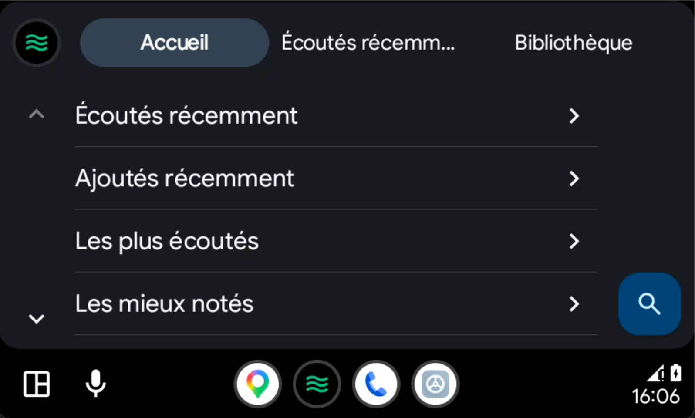

Wavio est une application de streaming musical pour Android qui se connecte à vos propres serveurs [Navidrome](https://www.navidrome.org/), [Jellyfin](https://jellyfin.org/) ou OpenSubsonic, ou qui lit directement une bibliothèque locale (fichiers locaux, partage SMB ou WebDAV). Votre musique, votre lecteur, à votre façon.

Elle est disponible sur le [Google Play Store](https://play.google.com/store/apps/details?id=com.jmercier.wavio) et en APK sur les [releases GitHub](https://github.com/Joel-Mercier/wavio/releases/latest).

## Une expérience complète

L'application propose tout ce que l'on attend d'un lecteur moderne : un écran d'accueil personnalisable (récemment écoutés, ajouts récents, playlists, genres, décennies, radios...), des écrans artiste, album et playlist, la recherche, une file d'attente éditable, un lecteur flottant et un lecteur plein écran avec gestes de navigation, informations de transcodage et paroles synchronisées (y compris le karaoké mot à mot de Navidrome).

Le téléchargement hors ligne des albums, playlists et titres, avec mise en file des actions effectuées hors connexion, permet de continuer à écouter sa musique n'importe où.

## Bien plus que de la musique

Au fil des versions Wavio s'est enrichie de nombreuses intégrations :

- Podcasts (recherche via l'API Taddy ou flux RSS personnels) et livres audio avec [Audiobookshelf](https://www.audiobookshelf.org/)
- Radios internet via l'API Radio Browser
- Scrobbling et statistiques avec [Last.fm](https://www.last.fm/) et [ListenBrainz](https://listenbrainz.org/)
- Similarité sonore par IA avec [AudioMuse-AI](https://github.com/NeptuneHub/AudioMuse-AI)
- Ajout de contenu à sa bibliothèque avec [Lidarr](https://lidarr.audio/), SoulSync et Tidarr
- Étiquetage des fichiers locaux avec [MusicBrainz](https://musicbrainz.org/)
- Lecture à distance via Chromecast, UPnP/DLNA ou le mode jukebox de Navidrome

## Intégration Android

Wavio s'intègre pleinement au système : Android Auto, widgets d'écran d'accueil, raccourcis du launcher, égaliseur, replay gain et minuteur de mise en veille. La sauvegarde et la restauration (y compris automatiques) des réglages sont également disponibles.

## Un projet communautaire

Le dépôt est un monorepo [Bun](https://bun.sh/) qui regroupe l'application mobile [Expo](https://expo.dev/) et le site de présentation construit avec [Astro](https://astro.build/). L'application est testée de bout en bout avec [Maestro](https://maestro.dev/).

Grâce à la communauté, Wavio est traduite en neuf langues via [Crowdin](https://crowdin.com/project/wavio) : anglais, français, allemand, italien, espagnol, portugais brésilien, chinois, russe et polonais. Le projet bénéficie également des programmes open source de Crowdin et [Sentry](https://sentry.io).
